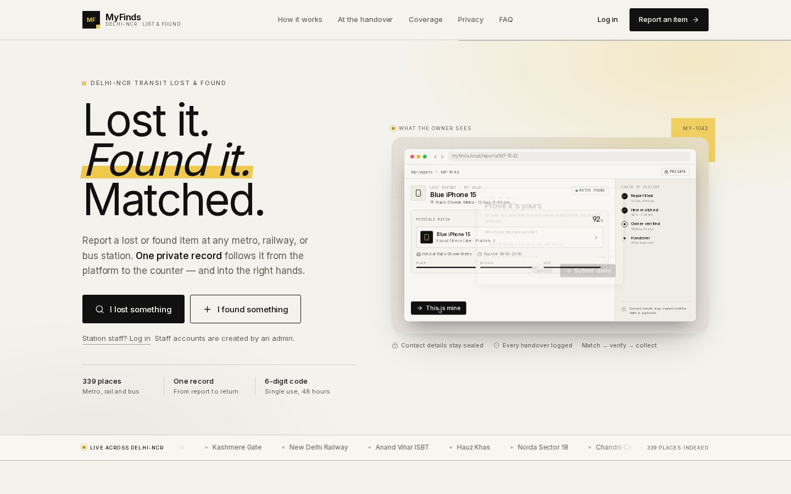
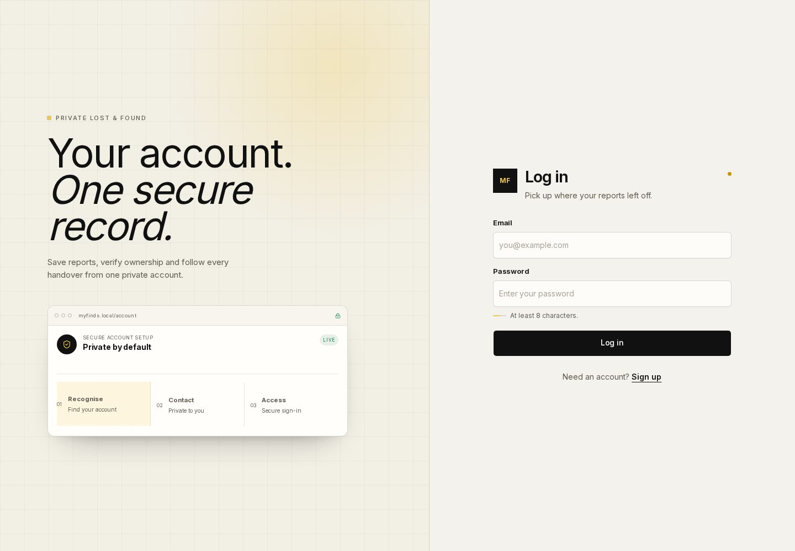
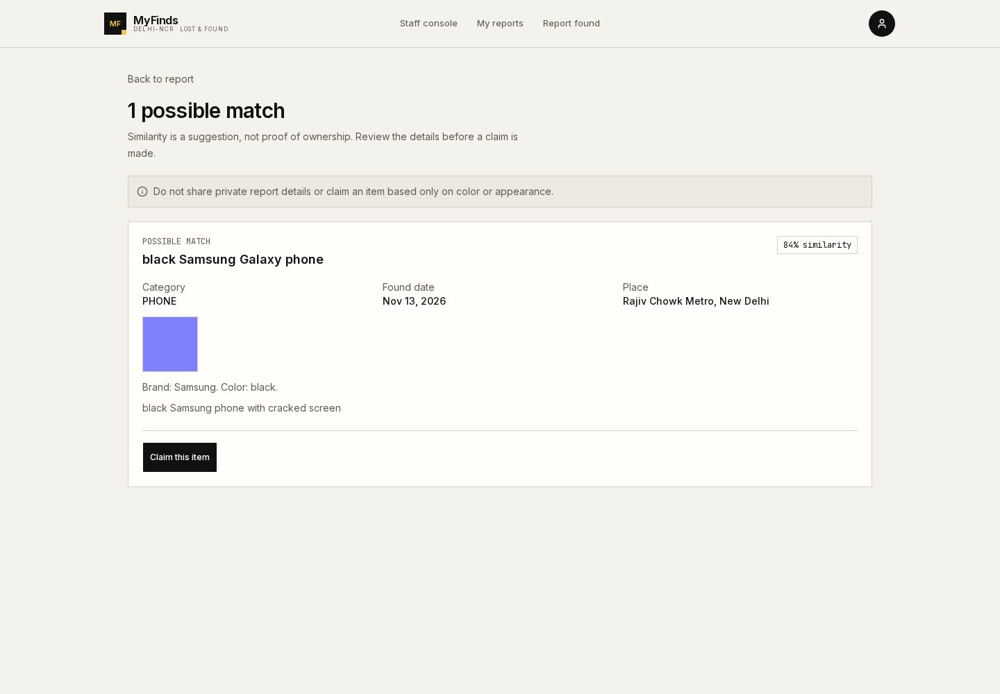
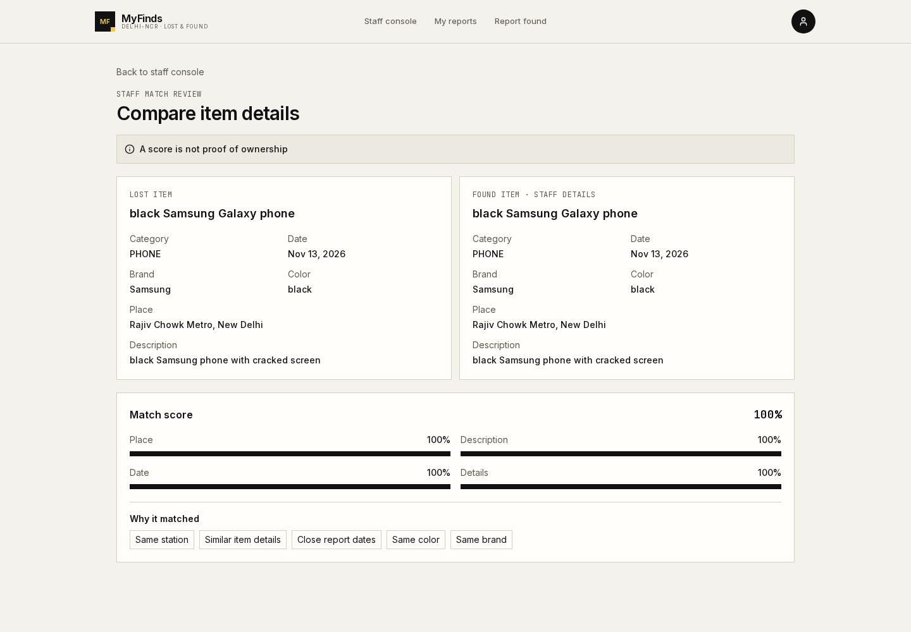
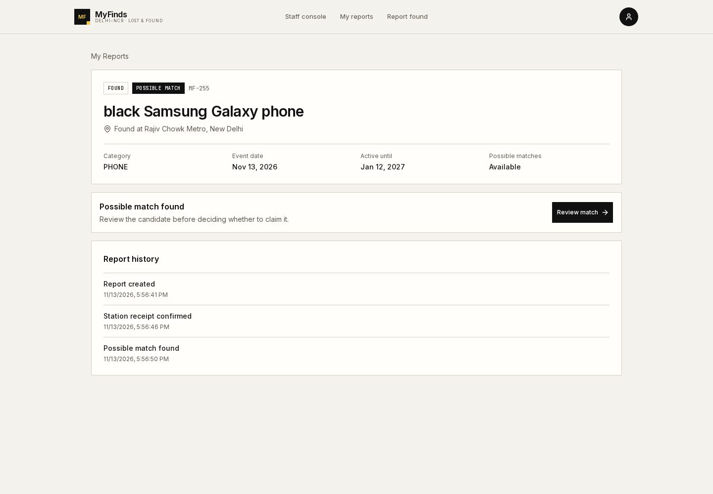
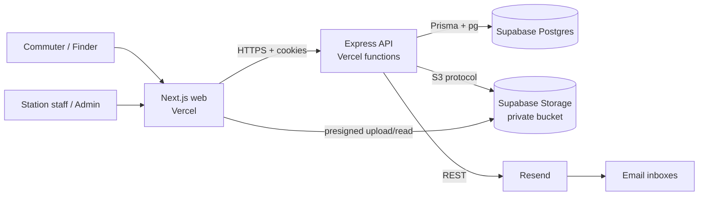

# MyFinds

**Lost & found for the Delhi-NCR transport network.** Report a lost or found item at any metro, railway, or bus station. MyFinds matches it, verifies the owner, and moves it through a private handover with a one-time code.

[Live web](https://myfinds-web.vercel.app) · [Live API](https://myfinds-server.vercel.app) · [Handover document](docs/HANDOVER.mdx) · [Demo credentials](docs/DEMO_CREDENTIALS.md)



## Why

A lost phone or wallet usually starts a chain of phone calls, notice boards, and station counters that do not share a record. MyFinds gives both sides one private record:

- The owner files a **lost** report with the item details and the place/date.
- A finder files a **found** report and chooses to keep the item or hand it to a station.
- A rule-based engine produces a ranked shortlist with a transparent score.
- The owner **claims** a match by answering hidden verification questions.
- The finder or station staff **approve** the claim and issue a 6-digit handover code.
- The code is entered at handover; the item is marked returned.

No public browsing, no chat, no contact details exchanged before approval.

## What works

- Email/password accounts with `USER`, `STATION_STAFF`, and `ADMIN` roles.
- Lost/found report wizard with a fixed 339-place Delhi-NCR directory.
- Private photo uploads (presigned S3 flow, 5 MB limit, signed reads).
- Rule-based matching: category, city, station, date, text, colour, brand.
- Score breakdown and plain-language match reasons.
- Claims with verification questions and three attempts per match.
- Custodian review: finder holding the item, station staff, or admin.
- One-time 6-digit handover code, AES-256-GCM encrypted at rest, 48-hour expiry.
- Handover confirmation with constant-time code verification.
- Station staff console: receipt confirmation, match review, claim queue, handover.
- Private status link with timeline and rate limiting.
- Resend emails to claimant and finder after approval. The claimant gets the code; the finder never does.
- Append-only status history and privacy/leak tests.

## Screenshots

| Report a lost item | Potential matches |
| --- | --- |
|  |  |

| Staff match review | Found report status |
| --- | --- |
|  |  |

More screenshots: [`docs/screenshots/`](docs/screenshots/).

## Architecture



```text
myfinds/
├── apps/
│   ├── web/                  Next.js 16 App Router UI (port 3001)
│   └── server/               Express 5 API on Bun (port 3000)
├── packages/
│   ├── auth/                 Better Auth config
│   ├── db/                   Prisma multi-file schema, client, seed, SQL
│   ├── shared/               Zod schemas, matching rules, transport catalog
│   ├── ui/                   shadcn/ui primitives
│   └── config/               Shared TypeScript config
├── docs/                     Product, design, model, handover, screenshots
├── .vercelignore             Keeps CLI deploys under Vercel's 100 MB limit
└── turbo.json                Task graph
```

### Stack

| Layer | Technology |
| --- | --- |
| Monorepo | Bun workspaces + Turborepo |
| Web | Next.js 16, React 19, Tailwind 4, shadcn/ui |
| API | Express 5 on Bun, deployed as Vercel functions |
| Auth | Better Auth + Prisma adapter |
| ORM / DB | Prisma 7 + `@prisma/adapter-pg`, PostgreSQL (Supabase) |
| Search | `pg_trgm` + generated `tsvector` column |
| Photos | Supabase Storage via S3 protocol, private bucket |
| Email | Resend |
| Validation | Zod 4, shared client/server schemas |
| Tests | Bun test (server), Vitest + Testing Library (web) |

## Quick start

### Prerequisites

- Bun `1.4.2`
- Node.js 24
- PostgreSQL (Supabase recommended: pooled runtime URL + direct migration URL)
- An S3-compatible private bucket (Supabase Storage, R2, or S3)
- A Resend API key for email

### Install

```bash
git clone https://github.com/devxoshakya/myfinds.git
cd myfinds
bun install
```

### Configure

```bash
cp apps/server/.env.example apps/server/.env
cp apps/web/.env.example apps/web/.env
```

Fill in `apps/server/.env` and `apps/web/.env`. The important server variables:

| Variable | Purpose |
| --- | --- |
| `DATABASE_URL` | Pooled Postgres runtime URL |
| `DIRECT_URL` | Direct Postgres URL for Prisma CLI |
| `BETTER_AUTH_SECRET` | Auth signing + handover-code key derivation |
| `BETTER_AUTH_URL` | API origin (`http://localhost:3000`) |
| `CORS_ORIGIN` | Web origin (`http://localhost:3001`) |
| `S3_ENDPOINT`, `S3_REGION`, `S3_ACCESS_KEY_ID`, `S3_SECRET_ACCESS_KEY`, `S3_BUCKET_NAME` | Private photo storage |
| `RESEND_API_KEY` | Resend API key |
| `EMAIL_FROM` | Sender identity; defaults to `MyFinds <onboarding@resend.dev>` |
| `APP_URL` | Public web URL used in email links |

Web:

| Variable | Purpose |
| --- | --- |
| `NEXT_PUBLIC_SERVER_URL` | API origin (`http://localhost:3000`) |

See [`docs/HANDOVER.mdx`](docs/HANDOVER.mdx) for the full reference and production values.

### Database

```bash
set -a
. ./apps/server/.env
set +a

bun run db:generate
bun run db:push
bun run db:seed

# Generated columns and the append-only trigger are raw SQL.
cd packages/db
bunx --bun prisma db execute --file prisma/sql/extensions.sql
```

### Run

```bash
bun run dev
```

- Web: `http://localhost:3001`
- API: `http://localhost:3000`

### Demo accounts

| Role | Email | Password |
| --- | --- | --- |
| Station staff | `staff@myfinds.pro` | `staff123` |
| Admin | `admin@myfinds.pro` | `admin123` |

These are demo-only and must be rotated before a real launch. See [`docs/DEMO_CREDENTIALS.md`](docs/DEMO_CREDENTIALS.md) for how they are created.

## Tests and checks

```bash
cd apps/server && bun test        # 81 pass
cd apps/web && bun run test       # 32 pass (Vitest)
bun run check-types               # 6/6 packages
bun run build                     # requires server env for db:generate
```

Run `bun run test` for the web app, not `bun test`; the web suite uses Vitest.

## Deploy

Two Vercel projects:

| Project | Root directory | Build |
| --- | --- | --- |
| `myfinds-web` | `apps/web` | `bun run build` |
| `myfinds-server` | `apps/server` | `bun run db:generate && node scripts/materialize-deps.mjs` |

Deploy from the **repo root** so Vercel can apply each project's root directory:

```bash
vercel --prod --yes --project myfinds-server
vercel --prod --yes --project myfinds-web
```

Production env:

- Server: `DATABASE_URL`, `DIRECT_URL`, `BETTER_AUTH_SECRET`, `BETTER_AUTH_URL`, `CORS_ORIGIN`, `S3_*`, `RESEND_API_KEY`, `EMAIL_FROM`, `APP_URL`.
- Web: `NEXT_PUBLIC_SERVER_URL`.

`BETTER_AUTH_URL` is the API URL. `CORS_ORIGIN` and `APP_URL` are the web URL.

> **Resend note:** `onboarding@resend.dev` only delivers to the Resend account owner's email. Verify a domain in Resend and update `EMAIL_FROM` before emailing real users.

## Documentation

| Document | What it covers |
| --- | --- |
| [`docs/HANDOVER.mdx`](docs/HANDOVER.mdx) | Full handover: product, flows, architecture, setup, deploy, security, tests, limitations |
| [`docs/PRD.md`](docs/PRD.md) | Product requirements and behavior rules |
| [`docs/DESIGN.md`](docs/DESIGN.md) | Visual system and UI rules |
| [`docs/model.md`](docs/model.md) | Data model and invariants |
| [`docs/DEMO_CREDENTIALS.md`](docs/DEMO_CREDENTIALS.md) | Demo staff/admin accounts |

## Known limitations

- No CI workflow; tests and type-check run locally before deploy.
- Rate limits are in-memory per serverless instance, not distributed.
- No queue or cron: emails are best-effort, report expiry is logical, and photos are not automatically purged.
- No email verification or password reset yet.
- No admin UI for stations/staff; use the seed and `staff:create`.
- `onboarding@resend.dev` is demo-only; verify a domain for real recipients.
- Matching is rule-based; there is no AI or image recognition.
