# MyFinds — Project Handover

> **How to use this document.** This is the single operational and technical handover for MyFinds. It covers the product, every implemented flow, the architecture, local setup, deployment, security rules, testing, known limitations, and the checklist for taking over. It is written as MDX so it can be opened in Claude or ChatGPT and rendered to PDF. Mermaid blocks can be rendered by any Mermaid-capable viewer; if the PDF tool cannot render them, ask the model to convert each Mermaid block to a diagram image.

## 0. Handover summary

| Item | Value |
| --- | --- |
| Product | MyFinds — lost & found for Delhi-NCR metro, rail, and bus |
| Repository | `https://github.com/devxoshakya/myfinds` |
| Live web app | `https://myfinds-web.vercel.app` |
| Live API | `https://myfinds-server.vercel.app` |
| Primary stack | Next.js 16, React 19, Express 5 on Bun, Prisma 7, PostgreSQL (Supabase), Better Auth, Resend |
| Hosting | Vercel (two projects: `myfinds-web`, `myfinds-server`) |
| Database | Supabase Postgres (pooled runtime URL + direct migration URL) |
| Photo storage | Supabase Storage via the S3 protocol (private bucket) |
| Transactional email | Resend |
| Current state | Live MVP; core report → match → claim → handover flow is implemented and deployed |
| Handover date | 27 November 2026 |

The product is intentionally narrow: one private record follows a lost or found item from the first report to the physical handover. It is not a public classifieds board, not a chat product, and not an AI matching system.

---

## 1. The product

### 1.1 Problem

A commuter loses a phone, wallet, bag, or ID card on the Delhi-NCR transport network. The item may be found by another commuter or handed to station staff. Today the recovery path is fragmented: phone calls, notice boards, informal WhatsApp groups, and station counters that do not share a record. Owners often cannot prove ownership, and finders do not want to publish their contact details.

### 1.2 Solution

MyFinds gives both sides one private record:

1. A commuter files a **lost** report with item details and the place/date.
2. A finder files a **found** report, chooses to keep the item or hand it to a station, and can add hidden verification questions.
3. A **rule-based matching engine** compares category, city, station, date, text, colour, and brand. It produces a ranked shortlist with a score breakdown and plain-language reasons.
4. The lost owner **claims** a match by answering the finder's verification questions.
5. The **custodian** — the finder holding the item, station staff, or an admin — approves or rejects the claim. Approval issues a **6-digit one-time handover code**.
6. The owner shows the code at the counter or to the finder. The custodian enters it, records the ID **type** (never the ID number), and the item is marked returned.

The system never reveals personal contact details before approval. The claimant receives the code; the finder receives a notification that the claim was accepted but never receives the code.

### 1.3 In scope (MVP)

- Email/password accounts with three roles: `USER`, `STATION_STAFF`, `ADMIN`.
- Lost and found reports with a fixed station directory (no free-text locations).
- Private item photos and an optional private proof photo.
- Rule-based matching with a transparent score.
- Claims with verification questions, three attempts per match.
- Custodian review and approval/rejection.
- One-time handover codes, expiry, and constant-time verification.
- Station staff receipt confirmation, match review, claim review, and handover.
- Private status links for report tracking.
- Transactional email to the claimant and finder on approval.
- Responsive web UI and installable PWA shell.
- Audit history for report status changes.

### 1.4 Explicit non-goals

- No public item browsing or public search.
- No social login, phone OTP, or email verification in the MVP.
- No in-app chat between owner and finder.
- No AI/vector matching, image recognition, or LLM-generated descriptions.
- No free-text locations; every place comes from the seeded transport directory.
- No native iOS/Android app.
- No payments, shipping, or courier integration.
- No automated expiry/cleanup cron in the current deployment.

---

## 2. Users and permissions

### 2.1 Roles

| Role | Who | How created |
| --- | --- | --- |
| `USER` | Commuter who reports or claims an item | Self sign-up |
| `STATION_STAFF` | Staff at one or more stations | Admin/operator via `bun run staff:create` |
| `ADMIN` | Operator with access to every station | `bun run staff:create --role ADMIN` |

A finder is not a separate role. A finder is a `USER` who submitted a `FOUND` report and chose `custodian = FINDER`.

### 2.2 Permission matrix

| Action | Lost owner | Finder holding item | Station staff (custody station) | Admin |
| --- | --- | --- | --- | --- |
| Create a report | Yes | Yes | Yes | Yes |
| View own report detail | Yes | Yes | No (uses staff views) | No (uses staff views) |
| View matches for own lost report | Yes | No | No | No |
| Submit a claim | Yes | No | No | No |
| See expected verification answers | No | Yes | Yes | Yes |
| Approve/reject a claim | No | Yes | Yes | Yes |
| Issue/reissue handover code | No | Yes | Yes | Yes |
| Confirm handover | No | Yes | Yes | Yes |
| Confirm station receipt | No | No | Yes, own stations | Yes, any station |
| View staff queue and match review | No | No | Yes, own stations | Yes, any station |
| View private status link | Anyone with the token | Anyone with the token | Anyone with the token | Anyone with the token |

The server enforces these rules; the UI is not the security boundary. The central custodian check is `isCustodian()` in `apps/server/src/services/claims.ts`.

---

## 3. Feature inventory

### 3.1 Authentication and sessions

- Better Auth with the Prisma adapter.
- Email + password only.
- Role is a server-set `user.role` field; clients cannot set it (`input: false`).
- Session cookies are `httpOnly`, `secure`, and `sameSite: none`, which requires HTTPS in production.
- Trusted origin is `CORS_ORIGIN` (the web origin). Additional desktop origins can be passed to `createAuth`, but none are configured today.
- There is no email verification, password reset UI, 2FA, or social login in the MVP.

Relevant files: `packages/auth/src/index.ts`, `apps/server/src/services.ts`, `apps/web/src/components/auth-form.tsx`.

### 3.2 Lost and found reports

The report wizard collects:

- Type: `LOST` or `FOUND`.
- Title, category, description, colour, brand.
- Event date (no future dates) and optional time.
- Place: state → city → station/stop from the seeded directory.
- Optional place note (platform, gate, coach), max 120 characters.
- Up to **4 item photos** (JPEG, PNG, or WebP, max 5 MB each).
- For found reports only:
  - Custody choice: keep it yourself (`FINDER`) or hand it in at a station (`STATION`).
  - Hand-in station when `STATION` is chosen.
  - One or two verification questions with expected answers.
  - One optional private proof photo. It is visible only to the reporter and is never shown to a claimant.

Report creation is **idempotent**. The web client sends a UUID in the `Idempotency-Key` header. Replaying the same key with the same payload returns the original report; reusing the key with a different payload returns `409 IDEMPOTENCY_CONFLICT`. The status token is encrypted and stored; the raw token is returned in the creation response and on an idempotent replay.

Report numbers are `MF-<autoincrement>`. Reports expire logically after **60 days** (`REPORT_TTL_DAYS`); matching excludes expired reports.

Relevant files: `packages/shared/src/report-validation.ts`, `apps/server/src/services/reports.ts`, `apps/server/src/routes/reports.ts`, `apps/web/src/components/report-form/`.

### 3.3 Place directory

- The checked-in catalog contains **339 places**: 315 DMRC metro entries plus Indian Railways, DTC, and ISBT stops.
- The seed is idempotent and creates states, cities, and active stations.
- The API exposes `GET /api/places` with a 5-minute public cache.
- Matching uses persisted station and city IDs, so catalog updates do not require a separate matching migration.
- Free-text locations are rejected by the shared Zod schema.

Relevant files: `packages/shared/src/transport-catalog.ts`, `packages/db/prisma/seed.ts`, `apps/server/src/routes/places.ts`.

### 3.4 Photo pipeline

- Private S3-compatible storage (Supabase Storage in production).
- Upload is a three-step flow:
  1. `POST /api/photos/presign` returns a presigned PUT URL (15 minutes) and a generated key.
  2. The browser uploads directly to storage.
  3. `POST /api/photos/confirm` performs a `HEAD` request and verifies content type and size before creating the `Photo` row.
- Reads go through `GET /api/photos/:id/url`, which checks report ownership and returns a **5-minute** signed GET URL.
- Email images use a **24-hour** signed URL because email clients fetch images when the message is opened.
- Raw storage keys never leave the server.
- Max size: **5 MB** per photo. Allowed types: `image/jpeg`, `image/png`, `image/webp`.
- Soft delete exists (`deletedAt`), but no automated retention cleanup is running.

Relevant files: `apps/server/src/services/photos.ts`, `apps/server/src/routes/photos.ts`, `apps/web/src/lib/photo-upload.ts`.

### 3.5 Matching

Matching is deterministic and rule-based. It runs synchronously:

- After a report is created.
- When a report owner opens their report detail or matches page.
- After station staff confirm receipt of a found item.

Candidate filters:

- Opposite type (lost ↔ found).
- Same category.
- Same city.
- Found report must be in a matchable status.
- Neither report expired.
- Found event date is not before the lost date by more than 1 day and not more than 14 days after it.

Score:

```text
score = 0.30 × place + 0.30 × text + 0.20 × date + 0.20 × attributes
```

- `place`: 1.0 same station; 0.5 same city + same place type; 0.2 same city; 0 otherwise.
- `text`: 60% trigram similarity + 40% token overlap across title, description, brand, and colour.
- `date`: linear decay over 14 days.
- `attributes`: half colour match + half brand match.

Only matches with `score >= 0.65` (`MATCH_MIN_SCORE`) are kept. The top **5** per report are stored (`MATCH_MAX_PER_REPORT`). Each `Match` row stores the score and a JSON breakdown. Stale `SUGGESTED` matches are deleted when a report is refreshed.

Status effects:

- Any new match moves both sides to `MATCH_FOUND` (unless already further along).
- No matches moves the report to `MATCHING` (or leaves `SUBMITTED_TO_STOP` alone).
- Matching never auto-approves a claim; a human always decides.

Relevant files: `packages/shared/src/matching.ts`, `apps/server/src/services/matching.ts`.

### 3.6 Claims

- Only the owner of the lost report can claim a match.
- A claim contains the claimant's answers to the found report's verification questions.
- Each claim increments `Match.attemptsUsed` in the same transaction.
- Maximum **3 attempts per match** (`MAX_CLAIM_ATTEMPTS`). After the third rejection the match becomes `LOCKED`.
- A claim moves the match to `CLAIMED` and the lost report to `CLAIMED`.
- Claim submission is rate-limited to **10 per user per hour**.
- The UI shows the score breakdown and reasons, but the score is explicitly labelled as “not proof of ownership”.

Relevant files: `apps/server/src/services/claims.ts`, `apps/server/src/routes/claims.ts`, `apps/web/src/app/reports/[id]/matches/`.

### 3.7 Custodian review and approval

The custodian is:

- The finder who submitted a `FOUND` report with `custodian = FINDER`.
- Station staff assigned to the found report's custody station.
- Any admin.

Approval:

- Atomically changes the claim from `PENDING` to `APPROVED` with `updateMany({ where: { id, decision: "PENDING" } })`. This prevents two concurrent approvals from issuing two different codes.
- Marks the match `VERIFIED` and both reports `VERIFIED`.
- Issues a **6-digit** handover code.
- Stores only the AES-256-GCM ciphertext (`iv.tag.ciphertext`) in `Claim.handoverCodeEnc`; plaintext is never stored.
- Sets `handoverExpiresAt` to **48 hours** after issue.
- Writes `StatusHistory` rows for both reports.
- Returns the plaintext code internally so the notification service can reuse the exact code. The route strips it before responding to the client.

Rejection:

- Requires a reason of 1–500 characters.
- Moves the lost report back to `MATCHING` so the owner can try another match.
- After the third rejection the match becomes `LOCKED`.

Relevant files: `apps/server/src/services/claims.ts`, `apps/server/src/routes/claims.ts`, `apps/web/src/components/reports/claim-review.tsx`.

### 3.8 Handover

- The claimant sees the code on their report page after approval.
- The custodian enters the code to confirm the physical handover.
- Verification is constant-time (`crypto.timingSafeEqual`).
- The code must not be expired; it is single-use because `handedOverAt` is set.
- Station handovers require the **ID type** checked at the counter (e.g. “Aadhaar”, “Driving licence”). The ID number is never stored.
- On success:
  - Claim gets `handedOverAt` and `handedOverById`.
  - Match becomes `COMPLETED`.
  - Both reports become `RETURNED` and get `closedAt`.
  - Remaining `SUGGESTED` matches for the same found report become `DISMISSED`.
  - `StatusHistory` rows are written for both reports.
- Code attempts are rate-limited to **5 per claim per hour**.

Relevant files: `apps/server/src/services/claims.ts`, `apps/server/src/routes/claims.ts`, `apps/web/src/components/reports/claim-review.tsx`.

### 3.9 Station staff console

The staff console is available to `STATION_STAFF` and `ADMIN`:

- **Receipt confirmation:** a found report submitted to a station starts as `SUBMITTED_TO_STOP`. Staff confirm the stop physically received it, which moves it to `RECEIVED_BY_STOP` and re-runs matching.
- **Match review:** side-by-side lost/found details, score breakdown, and reasons. Staff see details that are hidden from public view.
- **Claim queue:** pending and approved claims for found items held at the staff member's stations, including the claimant's answers and the expected answers.
- **Handover:** enter the claimant's code, record the ID type, and complete the return.
- Admins see all stations. Staff see only their active `StationStaff` assignments.

Relevant files: `apps/server/src/routes/staff.ts`, `apps/server/src/services/staff.ts`, `apps/web/src/app/staff/`.

### 3.10 Private status tracking

- Every report gets a random 32-byte status token at creation.
- The `Report` row stores only the SHA-256 hash (`statusTokenHash`). The idempotency row stores an encrypted copy so a retried submission can return the same link. The raw token is returned in the creation response and on an idempotent replay.
- The token is embedded in a private URL: `/status/<token>`.
- The status page shows the report number, category, status, relevant date, and timeline only. It does not show personal details or photos.
- The page is `noindex`, `no-referrer`, and `no-store`.
- The lookup endpoint is rate-limited to **30 requests per IP per minute**.
- Anyone with the link can view the limited status. It is a bearer link, not an authenticated view.

Relevant files: `apps/server/src/services/report-status.ts`, `apps/server/src/routes/report-status.ts`, `apps/web/src/app/status/[token]/`.

### 3.11 Email notifications (Resend)

On **claim approval only**, two emails are sent after the database transaction commits:

| Recipient | Template | Contains |
| --- | --- | --- |
| Claimant (lost owner) | `CLAIM_APPROVED_CLAIMANT` | Item details, lost/found station, item photo, collection point and counter hours, the **same** 6-digit handover code, expiry |
| Finder (found reporter) | `CLAIM_APPROVED_FINDER` | Item details, found station, item photo, handover instructions. **No code, no claimant contact details** |

Reliability rules:

- Emails are sent only after the approval is committed.
- The code is passed from `decideClaim()` into the notifier; it is never regenerated.
- Resend idempotency keys:
  - `claim-approved/claimant/<claimId>`
  - `claim-approved/finder/<claimId>`
- A `Notification` row is created with `QUEUED`, then updated to `SENT` or `FAILED`.
- A failed email never fails the claim request.
- A failure to write the `Notification` row never blocks delivery.
- Logs record only `error.name`, never message bodies, codes, or credentials.
- There is **no retry queue or cron** in the current code. Failed notifications stay `FAILED` until an operator retries manually.
- Resend idempotency keys expire after 24 hours; the database decision guard is the primary duplicate block.

Email configuration:

- `RESEND_API_KEY` is required.
- `EMAIL_FROM` defaults to `MyFinds <onboarding@resend.dev>`.
- `APP_URL` is used for links in emails; it falls back to `CORS_ORIGIN`, then `http://localhost:3001`.
- With `onboarding@resend.dev`, Resend only delivers to the Resend account owner's email. A verified domain is required before emailing real users.

Relevant files: `apps/server/src/services/email.ts`, `apps/server/src/services/notify.ts`, `apps/server/src/emails/`.

### 3.12 Privacy and abuse controls

- Expected verification answers are visible only to the custodian and admins (`S3` rule).
- Claimants never see the finder's email or the expected answers.
- Finders never see the claimant's email.
- Report serializers are hand-built per viewer; there is no generic “return the whole row” endpoint.
- Leak tests assert that secret owner details do not appear in unauthorized responses.
- Photos are private and served through short-lived signed URLs after an access check.
- Report status tokens are hashed at rest and compared with `timingSafeEqual`.
- Handover codes are encrypted at rest and compared with `timingSafeEqual`.
- Rate limits are process-local (see limitations).
- CORS allows only the configured web origin.
- Security headers: `X-Frame-Options: DENY`, `X-Content-Type-Options: nosniff`, `Referrer-Policy: strict-origin-when-cross-origin`, `Permissions-Policy` denies camera, microphone, and geolocation.

### 3.13 PWA shell

- `apps/web/src/app/manifest.ts` defines the installable manifest.
- `apps/web/public/sw.js` precaches `offline.html` and serves it only for failed navigation requests.
- Authenticated HTML and API responses are never cached.
- The service worker is registered by the PWA config; it is a lightweight offline fallback, not a full offline app.

### 3.14 Staff/admin provisioning

There is no admin UI for creating staff. Use the server script:

```bash
cd apps/server

bun run staff:create \
  --email staff@example.com \
  --password "a-strong-password" \
  --name "Staff Name" \
  --role STATION_STAFF \
  --station "Rajiv Chowk Metro" \
  --station "Central Secretariat Metro"

bun run staff:create \
  --email admin@example.com \
  --password "a-strong-password" \
  --name "Admin Name" \
  --role ADMIN
```

The script is idempotent for an existing email, but it does **not** reset an existing password. Delete and recreate the user, or add a password-reset flow, if a password must change.

---

## 4. End-to-end flows

### 4.1 Report a lost item

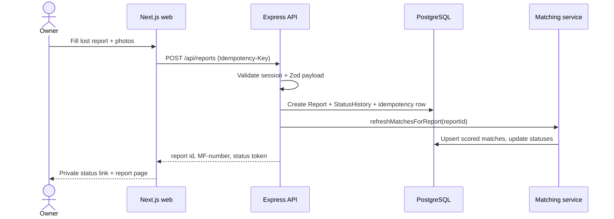

### 4.2 Report a found item — finder keeps it

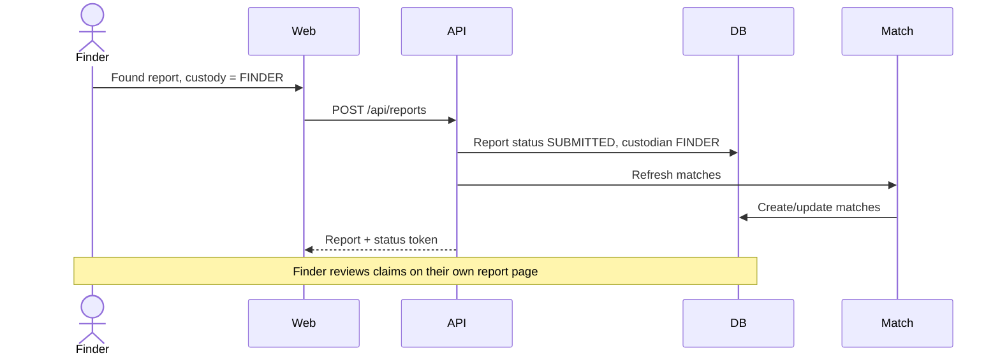

### 4.3 Report a found item — handed to a station

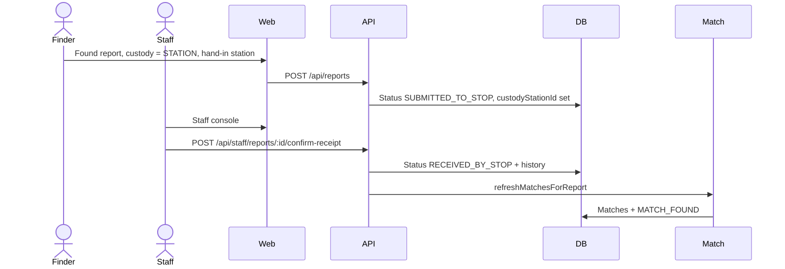

### 4.4 Matching

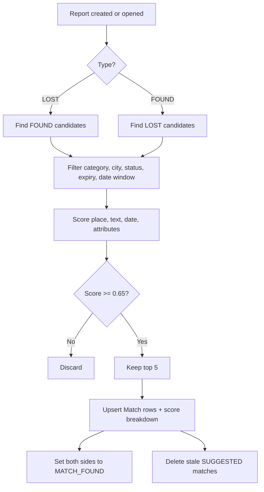

### 4.5 Claim a match

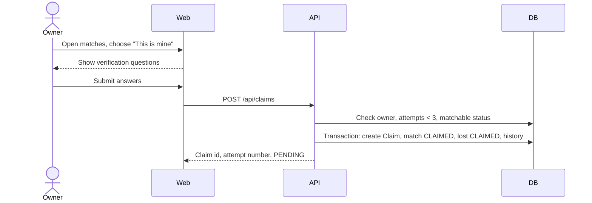

### 4.6 Approval and emails

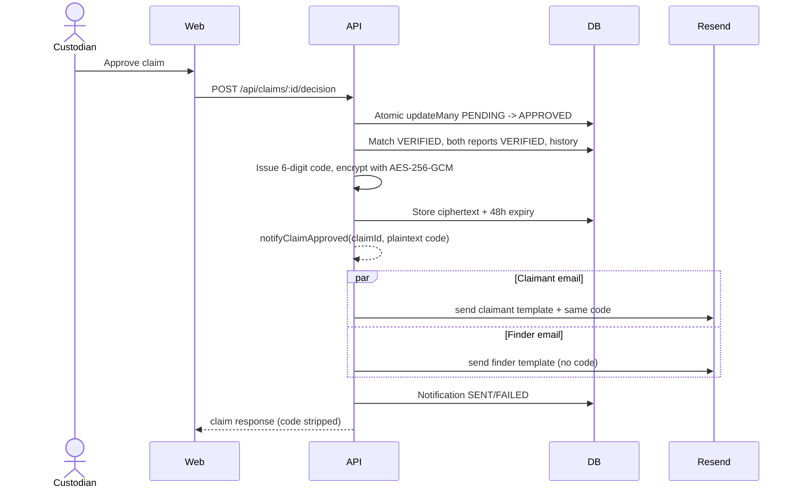

### 4.7 Handover

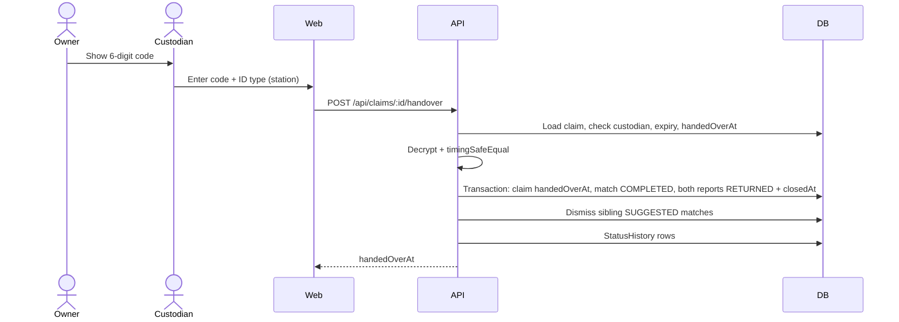

### 4.8 Private status lookup

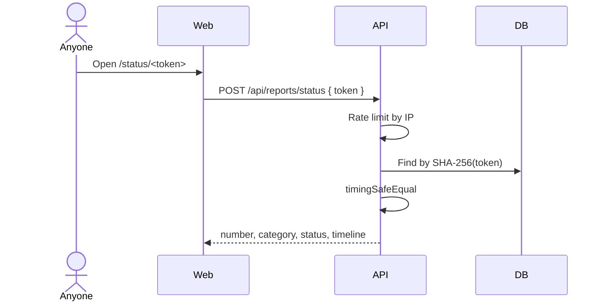

### 4.9 State machines

**Report status**

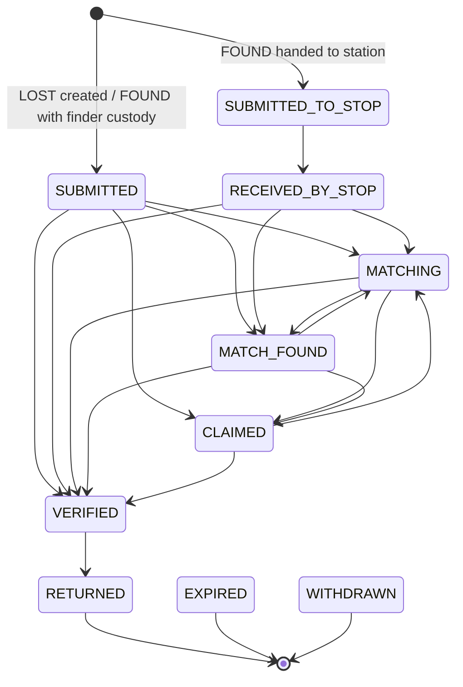

**Match status**

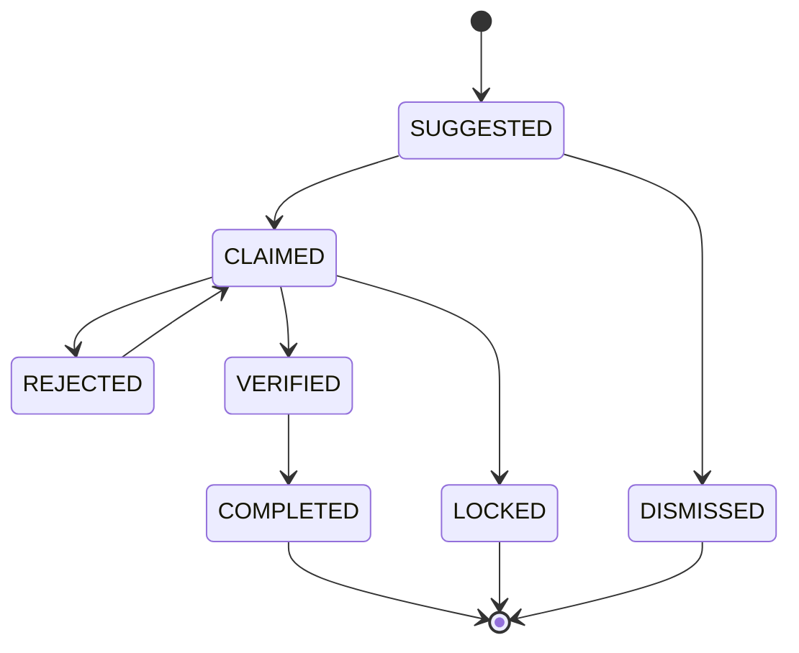

**Claim decision**

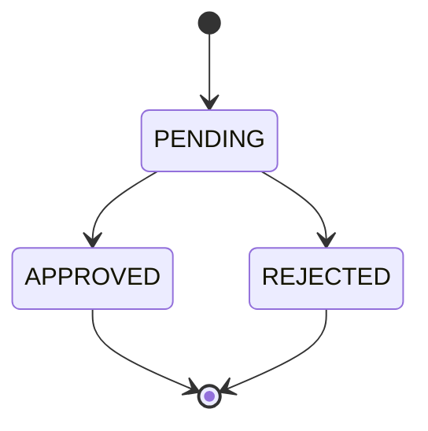

---

## 5. Architecture

### 5.1 System context

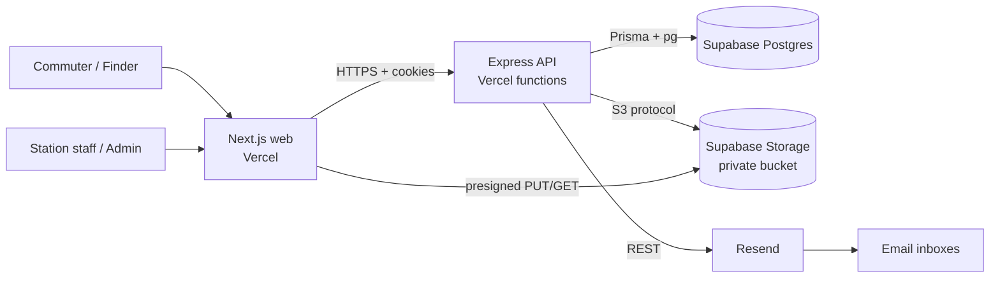

### 5.2 Monorepo layout

```text
myfinds/
├── apps/
│   ├── web/                  Next.js 16 App Router UI (port 3001)
│   │   ├── src/app/          Pages, layouts, manifest
│   │   ├── src/components/   UI, report wizard, marketing, staff views
│   │   ├── src/lib/          API client, auth client, photo upload
│   │   └── public/           Icons, manifest, service worker, offline page
│   └── server/               Express 5 API on Bun (port 3000)
│       ├── src/routes/       Thin HTTP routes
│       ├── src/services/     Business logic, auth, DB, photos, email
│       ├── src/emails/       Resend HTML + text templates
│       └── scripts/          staff:create, Vercel materialization
├── packages/
│   ├── auth/                 Better Auth config
│   ├── db/                   Prisma multi-file schema, generated client, seed, SQL
│   ├── shared/               Zod schemas, matching, transport catalog
│   ├── ui/                   shadcn/ui primitives
│   └── config/               Shared TypeScript config
├── docs/                     Product, design, model, handover, screenshots
├── .vercelignore             Keeps CLI deploys under 100 MB
├── turbo.json                Task graph
└── package.json              Bun workspaces + scripts
```

### 5.3 Stack

| Layer | Technology | Notes |
| --- | --- | --- |
| Monorepo | Bun workspaces + Turborepo | `bun@1.4.2` |
| Web | Next.js 16 App Router, React 19, Tailwind 4, shadcn/ui | Vercel, Node 24 |
| API | Express 5 on Bun | Vercel serverless functions |
| Auth | Better Auth 1.7 + Prisma adapter | Email/password |
| ORM | Prisma 7 + `@prisma/adapter-pg` | Multi-file schema, generated client |
| Database | PostgreSQL (Supabase) | Pooled runtime + direct migrations |
| Search | `pg_trgm` + generated `tsvector` column | Raw SQL in `prisma/sql/extensions.sql` |
| Photos | Supabase Storage S3 protocol | Private bucket, presigned URLs |
| Email | Resend SDK 6 | Plain HTML + text templates |
| Validation | Zod 4 | Shared client/server schemas |
| Tests | Bun test (server), Vitest + Testing Library (web) | See §9 |
| Hosting | Vercel | Two projects, manual deploy |

### 5.4 Request lifecycle

1. Browser calls the API at `NEXT_PUBLIC_SERVER_URL`.
2. CORS checks the request origin against `CORS_ORIGIN`.
3. Better Auth resolves the session cookie for protected routes.
4. The route validates the body with Zod.
5. The route calls a service with the Prisma client.
6. The service enforces ownership/role/status rules and writes in a transaction.
7. The route serializes only the fields the viewer is allowed to see.
8. Errors are logged with `describeError()` and returned as `{ error: { code, message } }`.

### 5.5 Data model

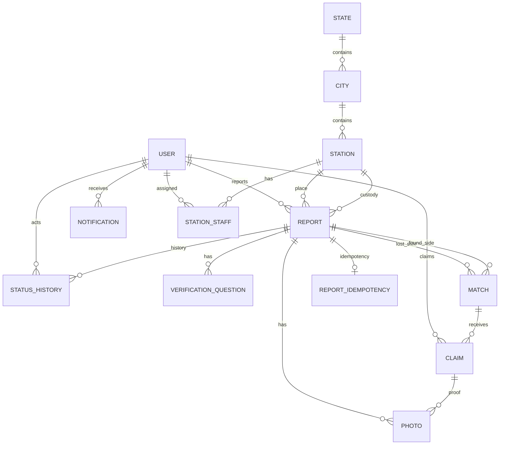

Core tables:

| Table | Purpose |
| --- | --- |
| `User` | Better Auth user + `role` (`USER`, `STATION_STAFF`, `ADMIN`) |
| `Session`, `Account`, `Verification` | Better Auth tables |
| `Report` | Lost/found item, status, custody, expiry, status token hash |
| `ReportIdempotency` | Hashed idempotency key + encrypted status token |
| `Photo` | Private storage key, kind, content type, size, soft delete |
| `VerificationQuestion` | Hidden question + expected answer |
| `Match` | Scored pair of lost/found reports, attempts, status |
| `Claim` | Claimant answers, decision, encrypted handover code, handover metadata |
| `StatusHistory` | Append-only audit trail (DB trigger blocks UPDATE/DELETE) |
| `Notification` | Email delivery log (`QUEUED`/`SENT`/`FAILED`) |
| `State`, `City`, `Station` | Fixed place directory |
| `StationStaff` | Staff-to-station assignments |

Database extras in `packages/db/prisma/sql/extensions.sql`:

- `pg_trgm` extension.
- Generated `Report.searchVector` column and GIN indexes.
- `status_history_append_only` trigger that raises on UPDATE/DELETE.

### 5.6 API surface

All routes are under the API origin. JSON errors use `{ "error": { "code": "...", "message": "..." } }`.

| Method | Path | Auth | Purpose |
| --- | --- | --- | --- |
| `ALL` | `/api/auth/*` | — | Better Auth handler |
| `GET` | `/` | — | Health check (`OK`) |
| `GET` | `/api/places` | — | Active station directory, 5-minute cache |
| `GET` | `/api/reports/mine` | User | Current user's reports |
| `GET` | `/api/reports/:id` | Owner | Report detail, claim context, photos, history |
| `GET` | `/api/reports/:id/matches` | Owner | Ranked matches + score breakdown |
| `POST` | `/api/reports` | User + `Idempotency-Key` | Create lost/found report |
| `POST` | `/api/reports/status` | — | Private status lookup by token |
| `POST` | `/api/photos/presign` | Owner | Get presigned upload URL |
| `POST` | `/api/photos/confirm` | Owner | Validate upload and create `Photo` |
| `GET` | `/api/photos/:id/url` | Owner | 5-minute signed read URL |
| `POST` | `/api/claims` | Lost owner | Submit a claim |
| `POST` | `/api/claims/:id/decision` | Custodian | Approve/reject a claim |
| `POST` | `/api/claims/:id/handover` | Custodian | Confirm handover with code |
| `GET` | `/api/staff/matches/:id` | Staff/Admin | Side-by-side match review |
| `GET` | `/api/staff/reports` | Staff/Admin | Station found-item queue |
| `GET` | `/api/staff/claims` | Staff/Admin | Pending/approved claim queue |
| `POST` | `/api/staff/reports/:id/confirm-receipt` | Staff/Admin | Confirm station receipt |

### 5.7 Services and responsibilities

| File | Responsibility |
| --- | --- |
| `apps/server/src/services.ts` | DB client, Better Auth instance, error logging helper |
| `services/reports.ts` | Create report, idempotency, status token encryption |
| `services/matching.ts` | Candidate query, scoring, match upsert/dismiss |
| `services/claims.ts` | Claims, custodian rules, approval/rejection, handover, code crypto |
| `services/staff.ts` | Staff queue, match review, receipt confirmation, claims list |
| `services/photos.ts` | Presign, confirm, signed reads, access check |
| `services/report-status.ts` | Private status lookup |
| `services/notify.ts` | Approval notification orchestration + `Notification` logging |
| `services/email.ts` | Resend client wrapper, `EMAIL_FROM`/`APP_URL` handling |
| `services/status-transitions.ts` | Legal report/match/claim transitions |
| `rate-limit.ts` | Process-local fixed-window limits |
| `routes/*` | Session checks, Zod validation, HTTP status mapping |

### 5.8 Background processing

There is **no queue, worker, cron, or scheduled job** in the current codebase.

- Matching runs synchronously in the request path.
- Emails are sent best-effort after approval.
- Report expiry is logical: `expiresAt` is checked by matching candidate filters, but nothing transitions rows to `EXPIRED`.
- Photo retention is not automated; `deletedAt` exists but no cleanup job runs.
- Failed notifications are not retried automatically.

The schema comments mention a daily notification retry; that is aspirational and is not implemented. Treat this document as authoritative.

### 5.9 Deployment topology

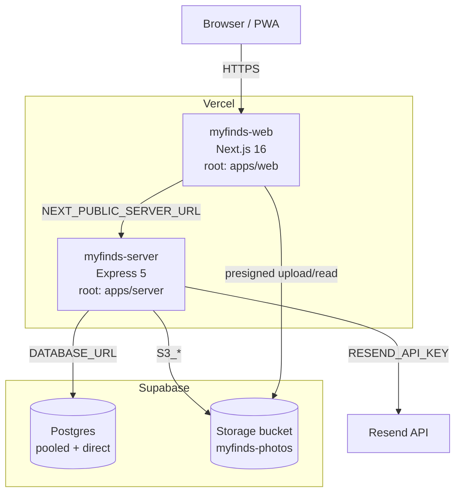

Production URLs:

- Web: `https://myfinds-web.vercel.app`
- API: `https://myfinds-server.vercel.app`
- Vercel projects: `myfinds-web` (root `apps/web`), `myfinds-server` (root `apps/server`).
- Both use Node 24.x and `bun install`.
- Server build command (from `apps/server/vercel.json`): generate Prisma client, then materialize workspace packages into CommonJS copies for the Vercel function runtime.

---

## 6. Local setup

### 6.1 Prerequisites

- Bun `1.4.2` (the repo pins `packageManager`).
- Node.js 24 (the server declares `node: 24.x`; Vercel uses 24.x).
- A PostgreSQL database. Supabase is recommended because the code assumes a pooled runtime URL and a direct migration URL.
- An S3-compatible private bucket. Supabase Storage works; Cloudflare R2 or AWS S3 also work with the same env shape.
- A Resend account and API key for email.
- Optional: Vercel CLI and a Vercel token for manual deploys.

### 6.2 Clone and install

```bash
git clone https://github.com/devxoshakya/myfinds.git
cd myfinds
bun install
```

`postinstall` runs `varlock codegen` for the web app, which generates `apps/web/src/env.ts` from `apps/web/.env.schema`.

### 6.3 Environment files

Copy the examples and fill them in:

```bash
cp apps/server/.env.example apps/server/.env
cp apps/web/.env.example apps/web/.env
```

Never commit `.env` files. The repo ignores them.

#### Server (`apps/server/.env`)

| Variable | Required | Default | Notes |
| --- | --- | --- | --- |
| `DATABASE_URL` | Yes | — | Pooled Postgres URL (Supabase transaction pooler, port 6543) |
| `DIRECT_URL` | Yes for Prisma CLI | — | Direct Postgres URL (port 5432) for `db push`/migrate/execute |
| `BETTER_AUTH_SECRET` | Yes | — | Long random string; also derives the handover-code key |
| `BETTER_AUTH_URL` | Yes | — | API origin, e.g. `http://localhost:3000` locally, `https://myfinds-server.vercel.app` in prod |
| `CORS_ORIGIN` | Yes | — | Web origin, e.g. `http://localhost:3001` locally, `https://myfinds-web.vercel.app` in prod |
| `S3_ENDPOINT` | Yes for photos | — | S3-compatible endpoint |
| `S3_REGION` | No | `auto` | Use `us-east-1` for Supabase Storage |
| `S3_ACCESS_KEY_ID` | Yes for photos | — | Storage access key |
| `S3_SECRET_ACCESS_KEY` | Yes for photos | — | Storage secret |
| `S3_BUCKET_NAME` | Yes for photos | — | Private bucket name |
| `RESEND_API_KEY` | Yes for email | — | Resend API key |
| `EMAIL_FROM` | No | `MyFinds <onboarding@resend.dev>` | Must be a verified domain sender in production |
| `APP_URL` | No | `CORS_ORIGIN`, then `http://localhost:3001` | Public web URL used in email links |

`VERCEL_TOKEN` may exist in a local `.env` for deploy scripts. It is not an app runtime variable and is not in `.env.example`.

#### Web (`apps/web/.env`)

| Variable | Required | Default | Notes |
| --- | --- | --- | --- |
| `NEXT_PUBLIC_SERVER_URL` | Yes | — | API origin, e.g. `http://localhost:3000` locally, `https://myfinds-server.vercel.app` in prod |
| `NODE_ENV` | No | `development` | Managed by Next/Vercel |

The web app uses varlock for typed env generation. `apps/web/.env.schema` is the source of truth for `NEXT_PUBLIC_SERVER_URL`.

### 6.4 Database setup

With `apps/server/.env` filled in:

```bash
# From the repo root, export the server env for Prisma CLI commands.
set -a
. ./apps/server/.env
set +a

bun run db:generate   # prisma generate
bun run db:push       # create/update tables from the schema
bun run db:seed       # seed states, cities, stations, demo reports
```

`db:push` cannot create generated columns or triggers. Apply the raw SQL once:

```bash
cd packages/db
bunx --bun prisma db execute --file prisma/sql/extensions.sql
```

This creates `pg_trgm`, the generated `Report.searchVector` column, the GIN indexes, and the `StatusHistory` append-only trigger.

If you use migrations instead of `db:push`:

```bash
bun run db:migrate
```

### 6.5 Run locally

```bash
bun run dev
```

- Web: `http://localhost:3001` (`next dev --port 3001`).
- API: `http://localhost:3000` (`bun run --hot src/index.ts`).
- `CORS_ORIGIN` must be `http://localhost:3001`.
- `NEXT_PUBLIC_SERVER_URL` must be `http://localhost:3000`.

Useful package-level commands:

```bash
bun run dev:web
bun run dev:server
bun run db:studio
bun run db:generate
bun run db:push
bun run db:seed
```

### 6.6 Create demo staff and admin

```bash
cd apps/server

bun run staff:create \
  --email staff@myfinds.pro \
  --password "staff123" \
  --name "Debug Kumar" \
  --role STATION_STAFF \
  --station "Rajiv Chowk Metro" \
  --station "Central Secretariat Metro"

bun run staff:create \
  --email admin@myfinds.pro \
  --password "admin123" \
  --name "Test Admin" \
  --role ADMIN
```

These are the demo credentials documented in `docs/DEMO_CREDENTIALS.md`. They are weak by design and must be rotated before a real launch.

### 6.7 Verify the install

```bash
cd apps/server && bun test          # 81 tests
cd apps/web && bun run test         # 32 tests (Vitest)
cd ../.. && bun run check-types     # 6/6 packages
bun run build                       # requires env for db:generate
```

If `bun run build` fails on `DIRECT_URL`, source `apps/server/.env` first:

```bash
set -a
. ./apps/server/.env
set +a
bun run build
```

---

## 7. Deployment

### 7.1 Vercel projects

| Project | Root directory | Framework | Build command |
| --- | --- | --- | --- |
| `myfinds-web` | `apps/web` | Next.js | `bun run build` |
| `myfinds-server` | `apps/server` | Express | `bun run db:generate && node scripts/materialize-deps.mjs` (from `vercel.json`) |

Both projects use Node 24.x and `bun install`.

### 7.2 Production environment variables

`myfinds-server` (Production):

- `DATABASE_URL`
- `DIRECT_URL`
- `BETTER_AUTH_SECRET`
- `BETTER_AUTH_URL=https://myfinds-server.vercel.app`
- `CORS_ORIGIN=https://myfinds-web.vercel.app`
- `S3_ENDPOINT`
- `S3_REGION`
- `S3_ACCESS_KEY_ID`
- `S3_SECRET_ACCESS_KEY`
- `S3_BUCKET_NAME`
- `RESEND_API_KEY`
- `EMAIL_FROM=MyFinds <onboarding@resend.dev>` (replace with a verified-domain sender)
- `APP_URL=https://myfinds-web.vercel.app`

`myfinds-web` (Production):

- `NEXT_PUBLIC_SERVER_URL=https://myfinds-server.vercel.app`

`BETTER_AUTH_URL` is the **API** URL. `CORS_ORIGIN` and `APP_URL` are the **web** URL.

### 7.3 Manual deploy (CLI)

Deploy from the **repo root** with the project name. The Vercel project root directory (`apps/server` or `apps/web`) is applied by Vercel; deploying from the subdirectory uploads the wrong root.

```bash
cd /path/to/myfinds

vercel --prod --yes --project myfinds-server
vercel --prod --yes --project myfinds-web
```

The repo includes `.vercelignore` to exclude `.git`, `.vercel`, `.turbo`, `.next`, and `node_modules` so the CLI upload stays under Vercel's 100 MB limit.

If a CLI deploy fails with `The specified Root Directory "apps/server" does not exist`, you are deploying from the subdirectory. Run from the repo root instead.

### 7.4 Git-based deploy

The Vercel projects can also deploy from GitHub. If Git integration is enabled, pushing to the production branch triggers a build using the project root directory. There is **no GitHub Actions workflow** in the repo; CI is not configured. Run tests and type-check locally before pushing.

### 7.5 Post-deploy smoke test

```bash
curl -sS https://myfinds-server.vercel.app/
# OK

curl -sS -o /dev/null -w "%{http_code}\n" https://myfinds-web.vercel.app/
# 200
```

Then manually verify:

1. Sign in as a normal user.
2. Submit a lost report and a found report in the same city/category.
3. Open the lost report and confirm a match appears.
4. Submit a claim with the verification answers.
5. Sign in as the finder/staff custodian and approve the claim.
6. Confirm both emails arrive (use the Resend dashboard if delivery is uncertain).
7. Confirm the claimant sees the code and the finder does not.
8. Enter the code as the custodian and confirm both reports become `RETURNED`.
9. Open the private status link and confirm the timeline.

### 7.6 Resend setup

1. Create a Resend account and API key.
2. For real recipients, verify a sending domain in Resend and add the DNS records (SPF, DKIM, DMARC as instructed).
3. Set `EMAIL_FROM` to an address on the verified domain, e.g. `MyFinds <no-reply@yourdomain.com>`.
4. Keep `onboarding@resend.dev` only for demos; it only delivers to the Resend account owner's email.
5. Check the Resend dashboard for delivery events. The app stores provider message IDs on `Notification` rows.

### 7.7 Storage setup

1. Create a private bucket (Supabase Storage or any S3-compatible store).
2. Set the five `S3_*` variables.
3. If the browser uploads directly, configure the bucket's CORS policy to allow `PUT`/`GET` from the web origin.
4. Keep the bucket private. The app uses presigned URLs; do not make objects public.
5. The key format is `reports/<reportId>/<kind>/<uuid>.<ext>`.

---

## 8. Security and privacy model

### 8.1 Trust boundaries

- The browser is untrusted. All role, status, custody, and ownership decisions happen on the server.
- The API is the only writer to the database.
- Photo storage is private; the browser only receives short-lived signed URLs after an access check.
- Email is outbound only; inbound email is not processed.

### 8.2 Secret handling

| Secret | Storage | Notes |
| --- | --- | --- |
| `BETTER_AUTH_SECRET` | Vercel env / local `.env` | Derives handover-code encryption key and idempotency encryption |
| `RESEND_API_KEY` | Vercel env / local `.env` | Never logged |
| `S3_SECRET_ACCESS_KEY` | Vercel env / local `.env` | Never logged |
| Database URLs | Vercel env / local `.env` | Include passwords |
| Handover code | Not stored in plaintext | AES-256-GCM ciphertext only |
| Status token | Hash on `Report`; encrypted copy for idempotent replay | Raw token returned in the creation response and on idempotent replay |
| Session cookie | Browser | `httpOnly`, `secure`, `sameSite: none` |

Do not put any of these in code, docs, screenshots, or Git. The repo's `.gitignore` excludes `.env` files, but always check `git status` before committing.

Rotating `BETTER_AUTH_SECRET` invalidates existing sessions, makes issued handover codes undecryptable, and breaks status-token replay for idempotency rows. Rotate it only when you accept those consequences (for example, during a security incident), and expect claimants with live codes to need a new approval/reissue.

### 8.3 Logging rules

- `describeError()` logs error name, Prisma code, first line of message, a short stack, and meta.
- Notification failures log only `error.name`.
- Handover codes, passwords, API keys, and session tokens must never be logged.
- Resend provider message IDs are stored on `Notification` rows; they are not secrets.

### 8.4 Known security gaps

- No email verification or password reset.
- No 2FA.
- Rate limits are in-memory per serverless instance; they are best-effort, not a distributed guarantee.
- No CSP header (other security headers are set).
- No virus scanning or image moderation for uploads.
- The UI caps item photos at four, but the photo API does not enforce a per-report count; a crafted client could add more rows.
- Private status links are bearer tokens; anyone with the link can view limited status.
- No admin audit UI; `StatusHistory` is the audit trail.
- No automatic secret rotation.

---

## 9. Testing and QA

### 9.1 Automated tests

| Suite | Command | Current result |
| --- | --- | --- |
| Server | `cd apps/server && bun test` | 81 pass, 0 fail, 452 assertions, 12 files |
| Web | `cd apps/web && bun run test` | 32 pass, 6 files (Vitest + Testing Library) |
| Types | `bun run check-types` | 6/6 packages |
| Build | `bun run build` | Passes when server env is sourced |

Important server test files:

- `apps/server/src/routes/leak.test.ts` — unauthorized responses do not leak private fields.
- `apps/server/src/services/claims.test.ts` — claim attempts, approval/rejection, handover, code reuse.
- `apps/server/src/services/notify.test.ts` — email orchestration, no duplicate send, code never leaked to finder.
- `apps/server/src/routes/claims.test.ts` — duplicate approval and code stripping.
- `apps/server/src/services/reports.test.ts` — idempotency, status token, report creation.
- `apps/server/src/services/matching.test.ts` — scoring and candidate filters.
- `apps/server/src/services/status-transitions.test.ts` — illegal transition guards.

Tests are mostly service/route unit tests with fakes. They do not call real Resend, real S3, or a production database.

### 9.2 Manual regression checklist

- [ ] Sign up, sign in, sign out.
- [ ] Submit a lost report with 0, 1, and 4 photos.
- [ ] Submit a found report with finder custody and verification questions.
- [ ] Submit a found report with station custody and a hand-in station.
- [ ] Confirm the report number and private status link.
- [ ] Confirm matching appears for a same-city/same-category pair.
- [ ] Confirm no match appears across categories or cities.
- [ ] Submit a claim with wrong answers; confirm it is still reviewable.
- [ ] Reject a claim; confirm the lost report returns to `MATCHING`.
- [ ] Use all three attempts; confirm the match locks.
- [ ] Approve a claim; confirm both emails and the code.
- [ ] Confirm the finder email has no code and no claimant email.
- [ ] Confirm the claimant sees the code and the finder does not.
- [ ] Confirm the code expires after 48 hours (or test with a shortened TTL in a branch).
- [ ] Confirm handover with the wrong code fails and the right code succeeds.
- [ ] Confirm station handover requires an ID type.
- [ ] Confirm both reports become `RETURNED` and sibling suggestions are dismissed.
- [ ] Confirm staff receipt confirmation re-runs matching.
- [ ] Confirm staff cannot access another station's queue.
- [ ] Confirm admin can access any station.
- [ ] Confirm status link works without login and is rate-limited.
- [ ] Confirm photo URLs expire and raw keys never appear in responses.
- [ ] Confirm mobile layout for the report wizard, matches, and claim review.

### 9.3 Accessibility and UX notes

- The UI uses labelled inputs, visible focus states, and semantic headings.
- The report wizard is long; test on a 360 px-wide viewport.
- Error messages are field-level and summarised.
- The landing page uses large display type; check contrast on the yellow accent.
- No formal screen-reader audit is recorded. Treat an accessibility pass as an open task.

---

## 10. Known limitations and next steps

### 10.1 Must-do before real users

1. **Verify a Resend domain** and replace `EMAIL_FROM`. `onboarding@resend.dev` only delivers to the account owner.
2. **Rotate demo passwords** and remove or disable demo staff/admin accounts.
3. **Confirm the storage bucket is private** and CORS is scoped to the web origin.
4. **Set strong production secrets** (`BETTER_AUTH_SECRET`, database password, S3 keys, Resend key).
5. **Run the manual regression checklist** against production.

### 10.2 Recommended next

- Add a distributed rate-limit store (Redis/Upstash) if the API scales horizontally.
- Add a queue/worker for email retries and delivery webhooks.
- Add scheduled jobs for report expiry, photo retention, and stale-match cleanup.
- Add email verification and password reset.
- Add an admin UI for stations, staff, and catalog management.
- Add Sentry or another error/performance monitor.
- Add a CI workflow (type-check, tests, build) on pull requests.
- Add end-to-end browser tests for the full report → claim → handover flow.
- Add image moderation and virus scanning for uploads.
- Add pagination to “My reports” and staff queues if data grows.
- Add a CSP and review cookie settings for cross-site behavior.
- Consider a reissue-code flow for expired codes (currently no UI).

### 10.3 Deliberate shortcuts

| Shortcut | Limit | Upgrade when |
| --- | --- | --- |
| In-memory rate limits | Per serverless instance, resets on cold start | Traffic grows or abuse appears |
| Synchronous matching | Runs in the request path | Candidate volume makes requests slow |
| Best-effort email | No retry, no queue | Email delivery becomes business-critical |
| Logical expiry | No `EXPIRED` transition or cleanup | Storage/report volume grows |
| No admin UI | Staff/stations managed by script/seed | Non-technical operators take over |
| Plain HTML emails | No React Email build step | Templates need shared components/previews |
| Bearer status link | Anyone with the link can view limited status | Stronger privacy is required |

---

## 11. Handover checklist

### Access

- [ ] GitHub repository access (or transfer ownership).
- [ ] Vercel team/project access for `myfinds-web` and `myfinds-server`.
- [ ] Supabase project access (database + storage).
- [ ] Resend account access and verified domain.
- [ ] DNS access for the sending domain.
- [ ] Any custom domain/DNS for the web app.

### Configuration

- [ ] Production env vars present and correct on both Vercel projects.
- [ ] `BETTER_AUTH_URL` points to the API; `CORS_ORIGIN` and `APP_URL` point to the web app.
- [ ] `NEXT_PUBLIC_SERVER_URL` points to the API.
- [ ] Resend sender is on a verified domain.
- [ ] Storage bucket is private and CORS is scoped.
- [ ] Demo accounts rotated or removed.

### Verification

- [ ] `curl` health check returns `OK`.
- [ ] Web app loads and sign-in works.
- [ ] One full report → match → claim → approve → handover flow completed in production.
- [ ] Both approval emails received.
- [ ] Private status link works.
- [ ] Staff console access is limited to assigned stations.
- [ ] Admin access works across stations.

### Knowledge

- [ ] New owner has read this document and `docs/PRD.md`, `docs/DESIGN.md`, `docs/model.md`.
- [ ] New owner knows the deploy command and the Vercel root-directory gotcha.
- [ ] New owner knows the Resend test-domain limitation.
- [ ] New owner knows there is no cron/queue and how to retry a failed notification.
- [ ] New owner knows how to create staff and seed the database.

---

## 12. Appendix

### 12.1 Command cheat sheet

```bash
# Install
bun install

# Local dev
bun run dev

# Database
set -a; . ./apps/server/.env; set +a
bun run db:generate
bun run db:push
bun run db:seed
cd packages/db && bunx --bun prisma db execute --file prisma/sql/extensions.sql

# Tests
cd apps/server && bun test
cd apps/web && bun run test
bun run check-types
bun run build

# Staff (see docs/DEMO_CREDENTIALS.md for full examples)
cd apps/server && bun run staff:create --email staff@example.com --password "change-me-123" --name "Staff Name" --role STATION_STAFF --station "Rajiv Chowk Metro"

# Deploy (from repo root)
vercel --prod --yes --project myfinds-server
vercel --prod --yes --project myfinds-web
```

### 12.2 Environment variable reference

| Variable | App | Secret | Purpose |
| --- | --- | --- | --- |
| `DATABASE_URL` | server | Yes | Pooled Postgres runtime connection |
| `DIRECT_URL` | server / Prisma CLI | Yes | Direct Postgres connection for schema commands |
| `BETTER_AUTH_SECRET` | server | Yes | Auth signing + handover/idempotency key derivation |
| `BETTER_AUTH_URL` | server | No | API origin |
| `CORS_ORIGIN` | server | No | Allowed web origin |
| `S3_ENDPOINT` | server | No | Storage endpoint |
| `S3_REGION` | server | No | Storage region |
| `S3_ACCESS_KEY_ID` | server | Yes | Storage access key |
| `S3_SECRET_ACCESS_KEY` | server | Yes | Storage secret |
| `S3_BUCKET_NAME` | server | No | Private bucket |
| `RESEND_API_KEY` | server | Yes | Resend API key |
| `EMAIL_FROM` | server | No | Sender identity |
| `APP_URL` | server | No | Web URL used in emails |
| `NEXT_PUBLIC_SERVER_URL` | web | No | API origin used by the browser |

### 12.3 Glossary

| Term | Meaning |
| --- | --- |
| Lost report | A report filed by the owner of a missing item |
| Found report | A report filed by a finder |
| Custodian | The person/station responsible for a found item |
| Match | A scored pair of one lost and one found report |
| Claim | The lost owner's proof attempt on a match |
| Handover code | 6-digit one-time code issued on approval |
| Status token | Private bearer token for the status page |
| Idempotency key | Client UUID that makes report creation safe to retry |
| `MF-<number>` | Human-readable report number |

### 12.4 File map for the next engineer

Start here:

- `apps/server/src/services/claims.ts` — the core claim/handover rules.
- `apps/server/src/services/matching.ts` — how matches are created.
- `apps/server/src/services/reports.ts` — report creation and idempotency.
- `apps/server/src/services/notify.ts` — approval email orchestration.
- `apps/server/src/services/photos.ts` — photo security.
- `packages/shared/src/matching.ts` — scoring constants and algorithm.
- `packages/shared/src/report-validation.ts` — shared report/claim schemas.
- `packages/db/prisma/schema/` — data model.
- `apps/web/src/components/report-form/` — the reporting wizard.
- `apps/web/src/app/reports/[id]/matches/` — owner claim UI.
- `apps/web/src/app/staff/` — staff console.
- `apps/server/src/routes/leak.test.ts` — the privacy contract in test form.

### 12.5 Screenshot index

The `docs/screenshots/` folder contains:

- `00-hero.jpg` — landing hero.
- `01-landing.jpg` — full landing page.
- `02-login.jpg` — login.
- `03-report-lost.jpg` — lost report wizard.
- `04-report-found.jpg` — found report wizard.
- `05-help.jpg` — help page.
- `06-my-reports.jpg` — signed-in report list.
- `07-lost-report-status.jpg` — lost report detail/status.
- `08-potential-matches.jpg` — ranked matches.
- `09-staff-match-review.jpg` — staff side-by-side match review.
- `10-found-report-status.jpg` — found report detail.

---

**End of handover.** For questions that this document does not answer, start with the tests and the service files listed in §12.4; they encode the intended behavior more precisely than the marketing copy.
